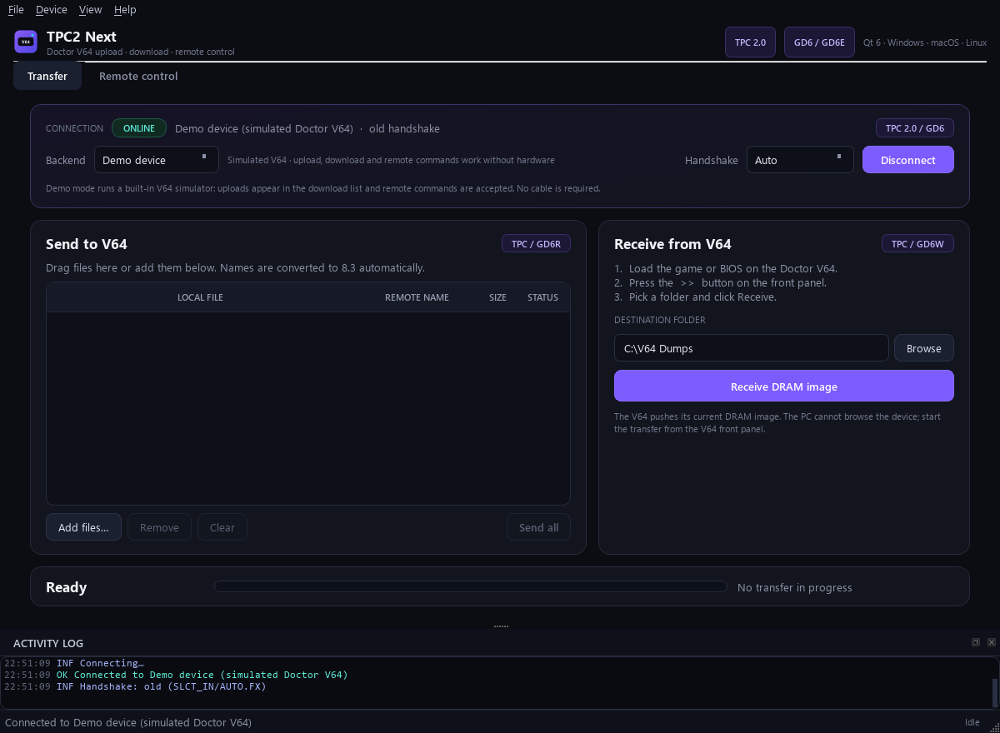
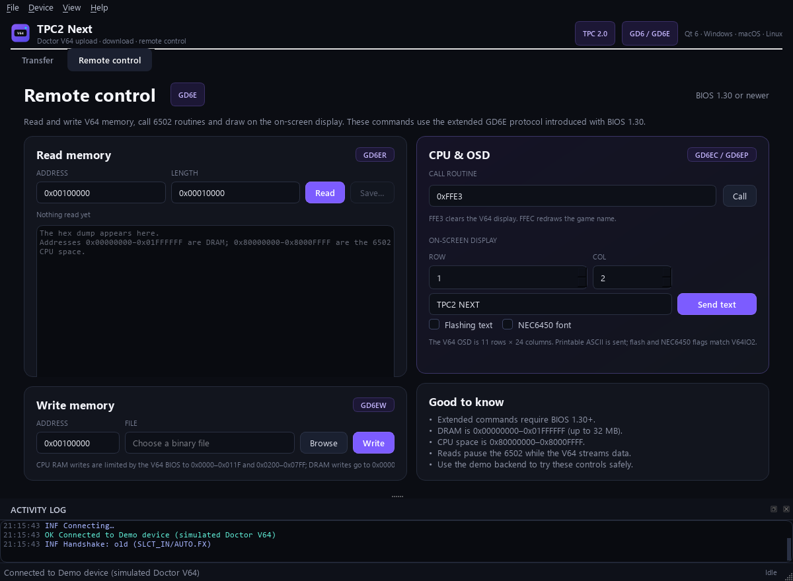

# TPC2 Next

[](https://github.com/dmang-dev/tpc2-next/actions/workflows/ci.yml)
[](LICENSE)
[](https://github.com/dmang-dev/tpc2-next/releases)

A modern, cross-platform replacement for Bung's **TPC2.EXE** upload/download
tool and **V64IO2.EXE** remote-control utility for the Doctor V64.

TPC2 Next is a native Qt 6 desktop application plus a scriptable command-line
tool. It talks to a real V64 through a Raspberry Pi Pico USB bridge or a legacy
parallel port, and it includes a built-in V64 simulator so every feature can be
tried without hardware.

Prebuilt Windows x64, Linux x86_64, and macOS arm64 packages are attached to the
[latest release](https://github.com/dmang-dev/tpc2-next/releases/latest). The
Linux and macOS packages include the Qt runtime; the Pico bridge firmware is
published there too. Source-build instructions are below.





## Highlights

- **Transfer page** — queue files, edit their 8.3 remote names, drag and drop,
  watch live throughput/ETA, and receive DRAM images pushed from the V64.
- **Remote control page** — the V64IO2 feature set: read memory, write memory,
  call 6502 routines, and print on the V64 OSD, including V64IO2's flashing-text
  and NEC6450 font flags.
- **Three backends** — Pico USB bridge (recommended), legacy PC parallel port,
  and a deterministic demo V64.
- **CLI** — every operation is scriptable for batch jobs and CI.
- **Cross-platform** — Windows 10/11, Linux and macOS. The bridge backend works
  on all three; legacy LPT is Windows/Linux only.
- **No byte-order or 8.3 guessing** — the original TPC 2.0/GD6 handshakes,
  nibble reads, big-endian GD6E arguments and 8.3 filename fields are preserved.

## Quick start without hardware

1. Build the project (below) or use a packaged build.
2. Start `tpc2` (or `tpc2.exe`).
3. Leave **Backend** on **Demo device** and press **Connect**.
4. Add a file and press **Send all**, or open **Remote control** and try a memory
   read, a routine call or OSD text.

The demo backend implements the same protocol state machine as the real device,
so it is also what the automated tests use.

## Build

Requirements: CMake 3.24+, Ninja, a C++20 compiler, Qt 6.4+ with Widgets and
SerialPort. The Pico bridge firmware is a separate CMake project and
additionally needs the Pico SDK and an Arm toolchain; see
[`firmware/pico/README.md`](firmware/pico/README.md).

### Windows (MSYS2 / UCRT64)

```powershell
winget install MSYS2.MSYS2
```

In an MSYS2 **UCRT64** shell:

```sh
pacman -S --needed \
  mingw-w64-ucrt-x86_64-gcc mingw-w64-ucrt-x86_64-cmake \
  mingw-w64-ucrt-x86_64-ninja mingw-w64-ucrt-x86_64-pkgconf \
  mingw-w64-ucrt-x86_64-qt6-base mingw-w64-ucrt-x86_64-qt6-serialport
```

From the project directory:

```sh
cmake -S . -B build/windows -G Ninja \
  -DCMAKE_BUILD_TYPE=Release \
  -DCMAKE_PREFIX_PATH=C:/msys64/ucrt64
cmake --build build/windows
./build/windows/tpc2.exe
```

On Windows, the build copies the required MinGW, Qt, and plugin DLLs next to
the executables. `build\windows\tpc2.exe` can be launched directly or
double-clicked without adding MSYS2's `bin` directory to `PATH`.

If the project lives on a UNC path (`\\server\share\...`), map it to a drive
first because CMake and `cmd.exe` cannot use UNC working directories:

```powershell
net use Z: \\server\share /persistent:no
```

Then build from `Z:\tpc2-modern`.

### Linux (Debian / Ubuntu)

```sh
sudo apt install build-essential cmake ninja-build \
  qt6-base-dev qt6-serialport-dev
cmake --preset linux
cmake --build --preset linux
./build/linux/tpc2
```

### macOS (Homebrew)

```sh
brew install cmake ninja qt
cmake --preset macos
cmake --build --preset macos
open build/macos/tpc2.app
```

On Intel Macs, point `CMAKE_PREFIX_PATH` at `/usr/local/opt/qt` instead of the
preset's `/opt/homebrew/opt/qt`.

### Tests

```sh
ctest --test-dir build/windows --output-on-failure
# or
./build/windows/tpc2_tests
```

The suite covers the handshake parser, CRC/framing, 8.3 names, upload and
download, extended commands, cancellation and BIOS filenames.

## Using the desktop app

### 1. Connect

| Backend | When to use it | What you need |
|---------|----------------|---------------|
| **USB bridge** | Recommended on every OS | Pico bridge + full-pin DB25 cable. Select the Pico's serial port. |
| **Parallel port** | Legacy PC with a real LPT port | Windows: InpOut32/InpOutx64 driver. Linux: root or `/dev/port` access. |
| **Demo device** | Trying the software, training, screenshots | Nothing. |

**Handshake** can stay on **Auto**. Auto tries the old BIOS handshake first,
then the newer one. Force **Old** or **New** only if auto-detection is flaky.

### 2. Send files to the V64

1. Choose the files with **Add files…** or drag them onto the table.
2. Double-click **REMOTE NAME** to change the 8.3 name stored on the V64.
3. Press **Send all**. Progress, speed and ETA are shown below the table.
4. The V64 must be on a screen that accepts a PC transfer (normally the
   upload/transfer menu).

Names are converted to 8.3 automatically. For example `Metroid Prime.z64`
becomes `METROID.Z64`; the exact result is shown before sending. BIOS update
images keep Bung's `V64_VERx.yz` naming convention.

### 3. Receive a DRAM image from the V64

1. On the V64, load the game/BIOS you want to dump.
2. Press the **>>** button on the V64 front panel.
3. In TPC2 Next choose a **destination folder** and press
   **Receive DRAM image**.

The V64 pushes its image; the PC cannot browse the device. If the V64 sends
several files, each one is written with its announced name, and duplicate names
get a ` (1)` suffix instead of being overwritten.

### 4. Remote control (modern V64IO2)

Open the **Remote control** tab after connecting. It is the direct replacement
for `V64IO2.EXE`:

- **Read memory** — enter an address and length (decimal or `0x` hex), then
  **Read**. The hex dump appears immediately and **Save…** writes the raw bytes
  to a file.
- **Write memory** — choose a binary file and an address, then **Write**.
- **CPU & OSD** — call a 6502 address, or send text to an OSD row/column.
  **Flashing text** sets V64IO2's D7 flag; **NEC6450 font** sets the D6 flag.

Address hints used by the V64 BIOS:

| Range | Meaning |
|-------|---------|
| `0x00000000`–`0x01FFFFFF` | DRAM (up to 32 MB) |
| `0x80000000`–`0x8000FFFF` | 6502 CPU space |
| `0x0000`–`0xFFFF` | Routine address for **Call** |

The GUI limits a single read to 16 MB to keep the hex view responsive; the
protocol and CLI support larger ranges.

## Command line

`tpc2cli` uses the same core as the GUI.

```sh
# List serial and parallel ports
tpc2cli ports

# Simulator
tpc2cli --backend demo info
tpc2cli --backend demo upload game.z64
tpc2cli --backend demo download ./dump
tpc2cli --backend demo read 0x00100000 65536 rom.bin
tpc2cli --backend demo write 0x00100000 rom.bin
tpc2cli --backend demo call 0xFFE3
tpc2cli --backend demo print 2 4 "HELLO V64"
tpc2cli --backend demo --flash print 2 4 "FLASHING"

# Real hardware through the Pico bridge
tpc2cli --backend bridge --port COM5 upload game.z64
tpc2cli --backend bridge --port /dev/ttyACM0 download ./dump

# Legacy parallel port
tpc2cli --backend lpt --lpt 0x378 upload game.z64
```

Options:

```
--backend demo|bridge|lpt   backend (default: demo)
--port NAME                 bridge serial port, e.g. COM5 or /dev/ttyACM0
--baud N                    bridge baud rate (default 115200)
--lpt 0x378                 parallel port base address
--mode auto|old|new         handshake (default: auto)
--flash                     OSD print: flashing characters (V64IO2 D7)
--nec                       OSD print: NEC6450 font (V64IO2 D6)
--verbose                   protocol details
```

Addresses and lengths accept `0x`-prefixed hexadecimal or decimal.

### Screenshots for documentation

The GUI can render itself without a display:

```sh
tpc2 --demo --screenshot docs/screenshots/transfer.png
tpc2 --demo --page remote --screenshot docs/screenshots/remote.png
tpc2 --demo --add game.z64 --screenshot shot.png
```

Use `QT_QPA_PLATFORM=offscreen` on a headless machine.

## Original utilities and their modern equivalents

| Original | TPC2 Next |
|----------|-----------|
| `TPC2.EXE` `out(file)` | **Transfer → Send all** / `tpc2cli upload` |
| `TPC2.EXE` `in(/file)` | **Transfer → Receive DRAM image** / `tpc2cli download` |
| TPC2 port prompt (1–4) | **Backend: Parallel port** + LPT base selector |
| `V64IO2.EXE read` | **Remote control → Read memory** / `tpc2cli read` |
| `V64IO2.EXE write` | **Remote control → Write memory** / `tpc2cli write` |
| `V64IO2.EXE call` | **Remote control → Call** / `tpc2cli call` |
| `V64IO2.EXE print` | **Remote control → Send text** / `tpc2cli print` |
| `V64IO2.EXE dump` | Read, then **Save…** |
| `V64IO2.EXE edit` | Read, save, edit in any hex editor, then **Write** |
| `V64IO2.EXE load` / `save` | **Write memory** / **Save…** |
| `V64IO2.EXE help` | This README and `docs/PROTOCOL.md` |

See `docs/MIGRATION.md` for a detailed comparison, including behaviour changes
and address-range notes.

## Hardware

- **Pico USB bridge (recommended):** wiring, BOM, level-shifter notes and
  firmware build instructions are in [`firmware/pico/README.md`](firmware/pico/README.md)
  and [`docs/HARDWARE.md`](docs/HARDWARE.md).
- **Legacy LPT:** Windows needs InpOut32/InpOutx64 and its kernel driver; Linux
  needs `ioperm` (root) or access to `/dev/port`. USB-to-parallel printer
  adapters generally cannot bit-bang this protocol.
- **macOS:** no legacy LPT support; use the Pico bridge.

The protocol and electrical details are documented in
[`docs/PROTOCOL.md`](docs/PROTOCOL.md).

## Packaging

CPack definitions are included. After a Release build:

```sh
cd build/windows
cpack -G ZIP          # portable ZIP
cpack -G NSIS         # Windows installer (if NSIS is installed)
```

```sh
cd build/linux
cpack -G DEB           # Debian/Ubuntu package
```

```sh
cd build/macos
cpack -G DragNDrop     # disk image
```

On Windows, the install rules run `windeployqt` and copy the MinGW runtime and
third-party DLLs (Freetype, ICU, libjpeg, …), so the ZIP is portable and does
not require MSYS2 on the target machine. The GUI and CLI share the deployed Qt
libraries. Test a package by extracting it and running `bin\tpc2cli.exe
--backend demo info` with a restricted `PATH`.

## Project layout

```
src/core/       Protocol, session and error handling (no Qt dependency)
src/io/         Bridge framing and serial transport
src/link/       Parallel, bridge and demo Link implementations
src/platform/   Windows/Linux/macOS parallel-port access
src/gui/        Qt 6 Widgets application
src/cli/        tpc2cli
tests/          Simulator-backed unit and integration tests
firmware/pico/  RP2040 USB bridge firmware
docs/           Protocol, hardware and migration documentation
.github/        CI workflow and issue/PR templates
scripts/        Repository formatting checks
```

## Compatibility notes

- The V64 protocol is 8.3-only. Long names are truncated deterministically and
  shown before transfer.
- TPC2's original 32 KB DOS buffer is gone; transfers stream in chunks.
- Extended commands require V64 BIOS 1.30 or newer.
- The V64IO2 documentation calls the GD6E length field "length-1", but the
  original code sends the actual byte count. TPC2 Next follows the code.
- OSD text is printable ASCII. Flash (D7) and NEC6450 (D6) flags are applied to
  every character, matching the V64IO2 protocol. The `0xFF` terminator is
  reserved.
- The implementation is validated against the simulator and protocol fixtures.
  Real-hardware timing can vary with BIOS revision and cable quality; see
  **Troubleshooting**.

## Troubleshooting

**"No answer from the V64"**
Check V64 power, the full-pin DB25 cable, and that the V64 is waiting for a PC
transfer. Try forcing **Handshake: Old** or **New**. On the bridge, confirm the
firmware LED toggles when you connect.

**"No serial ports found"**
Install the USB serial driver if your board is not a genuine Pico (RP2040 boards
with CH340/CP210x need their own driver). On Linux add your user to `dialout`.
Press **Refresh**.

**Parallel port unavailable on Windows**
InpOut32/InpOutx64 must be installed with its kernel driver, and the DLL must be
next to `tpc2.exe` (or in `System32`). A USB printer adapter will not work.

**Parallel port permission on Linux**
Run `tpc2cli`/`tpc2` with access to `/dev/port`, or as root. `ioperm` is used
first when available.

**Transfers stall or names look wrong**
Use a short, full-pin cable and a known-good 5 V supply. Remember that the V64
only stores 8.3 names; rename files in the queue if the converted name is not
what the V64 menu expects.

**Firmware build cannot find the Pico SDK**
Set `PICO_SDK_PATH` to the cloned `pico-sdk` directory and reconfigure.

## Contributing

See [`CONTRIBUTING.md`](CONTRIBUTING.md) for build commands, style checks, and
pull-request expectations. Please report security issues using the private
process in [`SECURITY.md`](SECURITY.md).

## Credits and licence

TPC2 Next is released under the MIT licence (see `LICENSE`). It is an
independent reimplementation of the documented TPC2/GD6 and V64IO2 protocols.
See `NOTICE` for trademark and third-party information. No original Bung source
code, binaries, or BIOS images are included in this repository.

Original Bung software reference:
<https://web.archive.org/web/19981212023426/http://www.bung.com.hk/>

Doctor V64 and Bung are trademarks of their respective owners. This project is
not affiliated with or endorsed by them.
